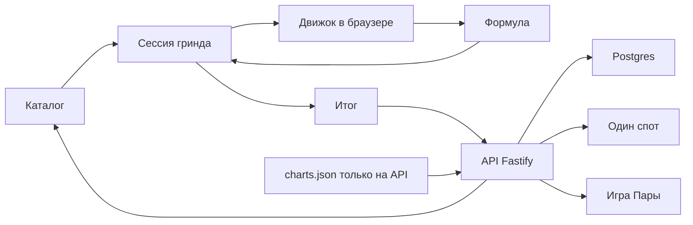

# Тренажёр холдема

Название приложения в шапке — «Тренажёр холдема». Внутри счёт, диапазоны, игра «Пары» и справочник. Слово «математика» остаётся именем раздела, не именем всего продукта.

## Что показало исследование

Сверил учебные форматы, у которых есть однозначный ответ и которые повторяются в приложениях и книгах: [Poker Gym](https://pokergym.me/drills), [Preflop+](https://craftywheel.com/preflopplus), [Poker Trainer](https://pokertrainer.se/), [Pot Commit](https://www.potcommit.com/), [Tools of Poker](https://www.toolsofpoker.com/en/exercises), [PokerChart VIP](https://pokerchart-vip.com/tools/math-quiz/), курс SplitSuit, а также *Essential Poker Math*, *Modern Poker Theory*, *Applications of No-Limit Hold'em* и *The Grinder's Manual*.

Общий паттерн сильных тренажёров: один вопрос на экран, мгновенная проверка, формула после ответа, отдельное мастерство по навыку, а не одна шкала опыта. Лучшие упражнения на счёт и математику — ауты, правило 2 и 4, пот-оддсы, сравнение цены колла с эквити, комбинации с блокерами, EV колла, MDF и безубыточная частота блефа, SPR. Запоминание диапазона работает как активное вспоминание: позиция и спот, случайная рука, выбрать действие. Рядом с вопросами — одна игра на зрительную память, «Пары»: тот же чарт, но без поля ответа. Рисование всей сетки 13×13 и полноценный GTO-симулятор раздач в первую версию не входят.

Отдельно сверю [GTO Wizard](https://help.gtowizard.com/how-to-use-the-trainer/), [GTO Lab](https://gtolab.com/) и [GTO Gecko](https://gtogecko.com/). Берём приёмы тренировки, не их библиотеки решений.

- GTO Wizard. Режим частоты для смешанных рук: на сложном уровне диапазонов после действия называется доля с шагом 10 процентных пунктов, зачёт при отклонении не больше 10. Пауза только после ошибки: верный ответ сразу открывает следующий вопрос, ошибка держит формулу до Enter. Сохранённый набор — позиция, стек и чарт в один клик, со своей статистикой. Клавиши на действия и на следующий вопрос. Вместо их EV loss в bb/100 пишем величину промаха: на сколько пунктов или комбо ответ уехал. Это поле в JSON ответа.
- GTO Lab. Орбита: один стек, ответы по кругу позиций из чартов открытия, не только с места героя. Сравнение стеков: одна рука на двух стеках рядом, это экран изучения, не вопрос. Кнопка «Тренировать» в статье справочника сразу открывает нужный уровень.
- GTO Gecko. Промахнутый шаблон вопроса возвращается в той же сессии, пока не будет двух верных ответов подряд. Эти повторы идут в квоту.

В первую версию не входят раздача до ривера, четыре стола сразу, ICM, nodelock, свой солвер, загрузка истории рук и рейтинг ELO поверх квоты. Это не отказ от них. У каждого пункта есть место в разделе «Дальше по продукту», и первая версия не должна его занять так, чтобы пункт пришлось встраивать ломая сессию.

В первую версию не входят банк-трекер, ICM, push/fold-солвер, постфлоп-деревья и симулятор полной раздачи. У них пока нет своего числа в `charts.json`. Пустой [holdem-trainer](https://github.com/VasyaRns/holdem-trainer) содержит только заголовок README. Место под эти режимы описано в разделе «Дальше по продукту».

Диапазоны берутся из локального [PokerSlover](/Users/vasyarns/Desktop/PokerSlover). Это закрытое приложение с MTT-чартами: 70 спотов в [server/data/charts.json](/Users/vasyarns/Desktop/PokerSlover/server/data/charts.json) (~1.5 МБ), типы в [client/src/types.ts](/Users/vasyarns/Desktop/PokerSlover/client/src/types.ts). Файл собран из `preflop-mtt.xlsx` скриптом `scripts/extract_charts.py`. Тренажёр не копирует его в клиент и не публикует: API читает путь `CHARTS_PATH` и отдаёт список спотов или один чарт.

Что внутри файла:

- Позиции `UTG, MP, MP1, HIJ, CO, BU, SB, BB`.
- 42 чарта открытия со стеком 10, 15, 20, 30, 40 или 50bb, идентификаторы вида `utg-open-10`.
- 28 чартов защиты (`mode: "vs"`) без стека, например `bb-vs-bu`. В книге они не зависят от стека.
- Рука, которой нет в `hands`, означает фолд. В первом чарте UTG 10bb сыграно 29 рук из 169.
- Клетка — `parts[]` с полями `action`, `weight`, `color`. 1557 клеток смешанные, например A8s = Open-2bb 0.36 и Push 0.64.
- Легенда смешивает действия (`Push`, `Open-2bb`, `Call`, `3bet 6-8bb`, `Limp`, `Raise`) и длинные пометки тренера про PKO и покрытие. В вопросах участвуют только действия, которые уже распознаёт `ACTION_RE` в `extract_charts.py`. Пометки показываются в разборе, но не являются кнопкой ответа.

## Стек

Клиент — Vite, React 19, TypeScript, Tailwind 4 и shadcn/ui, как в [PokerBot/web/package.json](/Users/vasyarns/Desktop/PokerBot/web/package.json). API — Fastify и TypeScript, как небольшой сервер PokerSlover. База — Postgres 16 и Prisma, как хранение в PokerBot. Всё поднимается `docker compose up --build`.

`localStorage` для результатов не используется. Файл чартов весит около 1.5 МБ и не должен попадать в сборку браузера, а сессии, ошибки и партии «Пар» должны остаться после закрытия вкладки и перезапуска контейнера. Это делает API и Postgres.

- Математика одного вопроса считается в браузере пакетом `packages/engine`, чтобы ответ появлялся сразу. Тот же пакет подключает API в тестах. Оцениватель руки — `pokersolver`. Эквити рука против руки — полный перебор оставшейся колоды.
- Чарты лежат только на API. Клиент просит список спотов, затем один спот.
- После каждого ответа клиент пишет его в `POST /api/sessions/:id/answers`. Открытие уровня, ошибки, достижения и итог «Пар» читаются из базы.
- Один локальный профиль, без регистрации и пароля: первая сессия создаёт единственную строку игрока. Это личный тренажёр в Docker, не многопользовательский сервис.
- Проверка — Vitest на движок и Fastify `inject` на маршруты. Экраны — в браузере. Для маршрутов с базой Postgres уже поднят compose.
- Навигация — React Router. Язык интерфейса — русский.

Compose, три сервиса:

- `postgres` — образ Postgres 16, том `pgdata`, проверка `pg_isready`.
- `api` — свой Dockerfile, после старта `prisma migrate deploy`, затем Fastify. Ждёт здоровую базу. Переменные `DATABASE_URL` и `CHARTS_PATH`. Файл чартов монтируется только на чтение: `../PokerSlover/server/data/charts.json` → `/data/charts.json`.
- `web` — nginx со сборкой клиента и прокси `/api` на `api`.

Локальный пароль Postgres живёт в `.env.example` и годится только для этого compose. Чарты в образ не копируются и в git не коммитятся. Если файла по `CHARTS_PATH` нет, API отвечает, что чарты не подключены, и не подставляет другой диапазон.

## Масштаб

Новый тренажёр, уровень, статья справочника или термин добавляются одним модулем или одной записью. Сессия, каталог, «Сегодня», прогресс и схема Postgres из-за этого не переписываются.

- npm workspaces: `packages/domain`, `packages/engine`, `client`, `server`. Общие квоты, идентификаторы и тексты справочника живут в `packages/domain`, чтобы клиент и API не расходились.
- Тренажёр — модуль с `id`, названием, уровнями, `generate`, `grade` и ссылкой на статью. Список модулей — реестр. Оболочка сессии принимает любой модуль и не знает про ауты или SPR. Тест оболочки идёт на поддельном модуле.
- Ответ в базе общий для всех тренажёров: `playerId`, `drillId`, `level`, JSON вопроса, JSON ответа, верно или нет, время. Новый тренажёр не требует миграции. Индекс `(playerId, drillId, level, createdAt)` держит выборку последних 20.
- Справочник и термины — данные в `packages/domain`, не отдельная вёрстка на каждое слово. Новое слово — объект `{ id, title, text, group }`.
- Чарт читается с диска один раз при старте процесса и лежит в памяти по `id`. Запрос отдаёт список или один спот. API без своей записи на диск: всё состояние в Postgres, файл чартов только на чтение. Второй экземпляр `api` поднимается тем же образом и тем же `DATABASE_URL`, без доработки кода.
- У каждой строки есть `playerId`. Сейчас создаётся один игрок и его id кладётся в cookie. Учётные записи не делаем, но второй игрок — это новая строка, а не смена схемы.
- Клиент по папкам `features/session`, `features/guide`, `features/ranges`, `features/pairs`, `features/progress`. Общие кнопки и поле ответа — в `components`. Маршруты только собирают фичи.

В первой версии один процесс API и один Postgres. Реплики, пул соединений и кэш чартов снаружи процесса не входят в работу, пока нагрузка это не потребует. Форма кода уже позволяет добавить реплику `api` в compose, не трогая тренажёры.

## Дальше по продукту

Первая версия отвечает из чартов и из формул. Следующие версии добавляют источник ответа, не новую сессию. Каталог, квота, «Сегодня» и таблица `Answer` остаются.

Спот в `packages/domain` — один тип на все источники. Сейчас в нём позиция, стек, оппонент, улица, борд и рука. Поля выплат, числа игроков до призов и стеков остальных мест есть в типе и в первой версии пустые. ICM потом заполняет их, математические тренажёры их не читают.

Источник ответа — интерфейс `SolutionSource`: по споту вернуть смесь действий или «не знаю». Первая реализация читает чарт PokerSlover. Push/fold, постфлоп и ICM садятся следующими реализациями того же интерфейса. Экран диапазона вызывает интерфейс, а не поля `charts.json`.

Тяжёлый расчёт не встаёт в запрос страницы. Пакет `packages/solver` подключает только API. Пока ответ мгновенный, маршрут `POST /api/solutions` отдаёт смесь сразу. Когда расчёт станет долгим, тот же маршрут отдаёт идентификатор задачи, клиент спрашивает готовность. Очередь и отдельный сервис солвера в compose в эту работу не входят: не должно быть кода, который умеет только синхронный ответ и не сможет потом вернуть задачу.

Новый солвер не добавляет колонку в `Answer`. Вопрос и эталонная смесь уже лежат в JSON. Квота и величина промаха считаются так же, как для чарта.

Тот же шов держит остальное из списка, который в первую версию не входит.

- Раздача до ривера. Сессия — цепочка спотов с общим `handId` в JSON вопроса. Сейчас цепочка из одного спота. Следующий спот той же руки добавляется, не меняя таблицу. Экран по-прежнему показывает одно решение.
- Четыре стола. У стола свой `sessionId`. Сейчас на экране один. Раскладка на четыре сессии садится в оболочку, состояние стола не хранится в одной глобальной переменной.
- ICM. Пустые поля спота: выплаты, число игроков до призов, стеки остальных мест. Источник ответа начинает их читать, математические тренажёры нет.
- Nodelock. Рядом со спотом необязательный замок частот узла. Первая версия поле не заполняет и не показывает. Источник ответа позже учитывает замок, не меняя экран вопроса.
- Свой солвер. Реализация `SolutionSource` в `packages/solver`, как выше.
- Загрузка истории рук. Разбор текста даёт список спотов. Дальше их проверяет тот же источник ответа. Это папка `features/history`, не новая форма ответа.
- ELO. Второе число, посчитанное из тех же строк `Answer`. Квота остаётся тем, что открывает уровень. Экран прогресса читает список показателей. Сейчас в списке одна квота, ELO добавляется вторым показателем и не заменяет её.
- Банк-трекер, push/fold и постфлоп-дерево. Банк — отдельные строки денег, не ответы тренажёра. Push/fold и дерево — ещё две реализации `SolutionSource`.

## Дизайн

Тёплый бумажный фон, тёмный текст, один глубокий зелёный акцент. Крупные цифры с `tabular-nums`, обычные красные и чёрные масти. На экране вопроса только спот, поле ответа и отправка с клавиатуры. После ответа — верно или нет, точное число и одна строка формулы. Экран прогресса показывает точность по каждому тренажёру, текущий уровень и серию. Без зелёного сукна, фишек и казино-графики. Это учебный инструмент, ставок в нём нет.

Если по цвету, шрифту, плотности или характеру экрана есть сомнение, код визуальной части не пишется. Сначала три варианта: у каждого название, фон, текст, акцент и одно предложение, чем он отличается. Пользователь выбирает. Уже принятый бумажный фон с зелёным акцентом не пересматривается без такого сомнения.

## Тренажёры и уровни

Уровень не закрывается одной короткой сессией. Это гринд: игрок остаётся на простом, пока не наберёт объём и точность, и только потом открывается средний. Сессия — 20 вопросов одного уровня одного тренажёра. Выход посередине не сбрасывает счёт: ответы уже в Postgres, следующий заход продолжает тот же уровень.

Квота, минимум:

- Простой: 60 ответов и не меньше 90% на последних 20.
- Средний: 80 ответов и не меньше 85% на последних 20.
- Сложный: 100 ответов и не меньше 80% на последних 20.

Если объём набран, а последние 20 ниже порога, уровень не открывается дальше. Новые вопросы добираются, пока порог не держится. На экране видно «48/60» и точность последних 20.

Семь математических тренажёров дают 7 × (60 + 80 + 100) = 1680 ответов, если порог взят ровно на квоте. По времени ответа это около 14 часов:

- Простой вопрос около 15 секунд, 60 вопросов — около 15 минут на тренажёр.
- Средний около 25 секунд, 80 вопросов — около 35 минут.
- Сложный около 40 секунд, 100 вопросов — около 65 минут.
- Один тренажёр на трёх уровнях — около 2 часов. Семь тренажёров — около 14 часов.
- Одна сессия из 20 вопросов — 5 минут на простом, 8 на среднем, 13 на сложном.
- По сессиям это 12 заходов на тренажёр и 84 на всю математику. Два захода в день — около шести недель. Один тренажёр за вечер — семь вечеров.

Диапазоны идут тем же гринд-объёмом. Вопрос короче, около 10, 15 и 25 секунд, поэтому три уровня всех спотов — ещё около 1,5 часа сверху к минимуму. «Пары»: 12, 16 и 20 засчитанных партий на простом, среднем и сложном, партия 2–4 минуты, ещё около 2,5 часов. Всё приложение до закрытия всех уровней — около 18 часов игры, не считая повторов после промахов.

Проверка в браузере на подшаге — это не прогон всей квоты. Достаточно начать уровень, ответить, увидеть счётчик и формулу. Полные 60, 80 и 100 считаются константой квоты и тестом на ней.

Первая кнопка каталога — «Сегодня». Это те же 20 вопросов, но тренажёр выбирается сам: самый слабый незакрытый уровень математики. Слабость — меньшая точность последних 20, при равенстве меньшая доля квоты. Если все уровни закрыты, берётся уровень с худшей точностью последних 20. Серия из семи дней растёт, когда дневной заход доведён до 20, а не от любого одного ответа.

Перед первым заходом на конкретный уровень показывается один решённый пример: спот, ответ и та же строка формулы, что после вопроса. Кнопка «Дальше» пишет в `LevelIntro`, что пример уже виден. Следующие заходы на этот уровень начинаются сразу с вопроса. Пример можно открыть снова с экрана уровня, но сам он больше не встаёт на пути.

- Ауты. Простой: только чистое дро, обе карты героя и флоп известны, рука оппонента нет. Флеш-дро 9, двустороннее 8, гатшот 4. Бэкдор сюда не входит. Средний: видимая карта снимает аут того же ранга или масти. Это снятие карты, не «грязный» аут. Сложный: обе руки открыты, ответ — число оставшихся карт, которые дают герою победу. Ничья не считается аутом.
- Правило 2 и 4. Множитель 4 только если за эту цену игрок видит и терн, и ривер. Множитель 2, если остаётся одна карта. На флопе, где впереди ещё ставка терна, множитель тоже 2: оплачена одна карта. Простой и средний спрашивают результат правила, целое число процентов. Сложный спрашивает точную вероятность добора до ближайшего процента: 9 аутов и две карты — 35, не 36. Комбо-дро на 15 аутов в простом уровне нет: правило даёт 60, точная вероятность 54.
- Пот-оддсы. Цена колла = колл / (банк перед игроком + колл). Банк перед игроком уже включает ставку оппонента и не включает колл. Пот-бет: банк был 10, ставка 10, перед коллером уже 20, колл 10, цена 10 / 30 = 33%. Полпота — 25%. Треть банка — 20%. Сложный: колл, если эквити больше цены. Если числа равны, EV нулевой, верны и колл, и фолд.
- Комбинации. Простой: пара 6, одномастные 4, разномастные 12. Средний: борд снимает комбо. Сложный: борд и свои карты. Один видимый туз оставляет у пары тузов 3 комбо, не 1 и не 6.
- EV колла. EV = эквити × (банк перед игроком + колл) − колл. Тот же банк, что в пот-оддсах. Плюс — колл, минус — фолд, ноль — оба ответа.
- MDF и альфа. Здесь банк — это банк до ставки, без самой ставки. MDF = банк до ставки / (банк до ставки + ставка). Альфа = ставка / (банк до ставки + ставка). Альфа + MDF = 1. Пот-бет: оба 50%. Полпота: альфа 33%, MDF 67%. Треть банка: альфа 25%, MDF 75%. Эти числа не подставлять вместо пот-оддсов.
- SPR. Эффективный стек / текущий банк. Только число. Порога «ниже четырёх — коммит» в ответе нет: это не формула.
- Диапазоны, источник — тот же `charts.json`. Простой: только открытие и чистые клетки (`weight` 1). Ответ — фолд, открытие, пуш или лимп, без точного сайзинга. Средний: открытие и защита, по-прежнему чистые клетки. Ответ — точное действие легенды (`Open-2bb`, `3bet 6-8bb`, `Call`, `Push`) или фолд. Сложный: смешанные клетки. Сначала действие с наибольшим весом, затем его доля шагом 10 процентных пунктов. В разборе видны все доли. Клетка, где цвет есть только у пометки тренера, в вопросы не попадает. Отдельный режим «Орбита» идёт по позициям одного стека. Сохранённый набор запоминает чарт. Экран «Стеки» показывает одну руку на двух стеках.

Клиент не хранит `charts.json`. Список спотов и один чарт приходят с API. Тесты ходят в маленький фикстур той же формы `Chart`. Если монтирования нет, экран диапазонов и игра показывают, что чарты не подключены, и не выдумывают свой чарт.

## Справочник

Отдельная страница `/guide`, ссылка в шапке рядом с прогрессом. Это не курс и не тренажёр. Текст годится новичку и не врёт опытному.

Каждая статья из трёх коротких частей, данные в `packages/domain`, не абзацы в вёрстке.

1. Что это. Одно предложение. Сокращение раскрыто в этой же строке.
2. Пример. Одно число или одна ситуация, которую можно пересчитать пальцем.
3. Где упрощение кончается. Одна оговорка для того, кто уже считает: формула врёт на краю, или тренажёра этого слова ещё нет.

Новичок читает первые две части. Третья не отменяет пример и не заменяет его другим числом.

Статьи формул, которые уже есть в тренажёрах, остаются. К ним добавляются статьи слов, которых в первой версии нет как режима. У такой статьи нет кнопки «Тренировать», вместо неё строка «Тренажёра пока нет».

- ICM, независимая модель фишек. На баббле фишка стоит не как деньги: вылет забирает долю всех призов, а удвоение стека эту долю не удваивает. Пример: призы 50, 30 и 20 при трёх игроках. Короткий стек коллирует олл-ин уже, чем если бы считали только фишки. Оговорка: без числа выплат статья не даёт частоту колла.
- Nodelock, замок узла. Вы фиксируете частоту одного действия и смотрите, как меняется ответ другого игрока. Пример: вместо колла 40% поставить коллу 70% и пересчитать блеф оппонента. Оговорка: в этой версии замок не задаётся.
- Солвер. Программа ищет частоты, при которых соперник не зарабатывает, просто сменив свои. Пример: чарт UTG 10bb уже такой ответ. Солвер нужен, когда спота в чарте нет. Оговорка: первая версия солвер не запускает.
- История рук. Текст раздачи из рума. Из него достают улицы, ставки и карты. Пример: строка «Hero calls 10» становится вопросом «колл был по цене или нет». Оговорка: загрузки файла пока нет.
- ELO. Число, которое растёт от верных ответов и падает от ошибок, как шахматный рейтинг. Пример: серия верных поднимает число, один грубый промах опускает сильнее, чем мелкий. Оговорка: уровень открывает квота, не ELO.
- Раздача до ривера. Одна рука, решение на флопе, потом на терне и на ривере. Пример: флеш-дро на флопе за 33%, на терне карта не пришла и цена уже другая. Оговорка: сейчас каждый вопрос отдельный, цепочки руки нет.
- Несколько столов. Несколько раздач на одном экране, как в онлайне. Пример: четыре вопроса сразу, у каждого свой банк. Оговорка: на экране один вопрос.
- Push/fold. Короткий стек, где остаются олл-ин или фолд. Пример: 10bb, UTG, рука либо в пуше чарта, либо фолд. Оговорка: это чтение чарта, отдельный солвер пуша не считается.
- Банк-трекер. Запись выигрыша и проигрыша по сессиям, не решение в раздаче. Пример: три сессии, +20, −15, +5 бб. Оговорка: записи результатов игры нет.
- Дерево ставок. Ветки после флопа: чек, ставка, рейз и что на них отвечают. Пример: флоп, ставка полпота, дальше терн и ривер. Оговорка: дерево в этой версии не строится.

Кнопка «Тренировать» остаётся только у статей, у которых есть уровень: ауты, правило 2 и 4, пот-оддсы, EV, комбинации, MDF и альфа, SPR, чарт.

Ниже статей — блок «Термины», якорь `#terms`. Список читается из `packages/domain`. У слова, у которого есть статья, ссылка на неё. Поле над списком оставляет строки, в которых есть набранные буквы. Строка термина — одно предложение, то же число, что в статье, без второго примера.

- Ауты. Флеш-дро — 9 карт масти, на флопе уже две этой масти. Двустороннее — 8, гатшот — 4. Бэкдорное флеш-дро — не 9 и не 10 аутов: после флопа это 10/47 × 9/46, около 4%, в счёте примерно один аут. Оверкарты — шесть карт, и только если пара ими старше руки оппонента.
- Правило 2 и 4. Четыре — только когда видны обе оставшиеся карты. Два — когда карта одна. Для 9 аутов правило даёт 36 и 18. Точно: 35% на две карты из 47 неизвестных и 20% на одну карту из 46, если карты оппонента не открыты. Если открыты, неизвестных на флопе 45, на терне 44.
- Пот-оддсы. Колл / (банк перед игроком + колл). Пример пот-бета: 10 в банк, ставка 10, перед коллером 20, колл 10, цена 33%.
- EV колла. Эквити × (банк перед игроком + колл) − колл. Ноль — оба ответа верны.
- Комбинации. Пара 6, одномастные 4, разномастные 12. Один видимый туз оставляет 3 комбо тузов.
- MDF и альфа. Банк до ставки, не банк после неё. Пот-бет: MDF 50% и альфа 50%. Полпота: MDF 67% и альфа 33%. Это не цена колла.
- SPR. Эффективный стек / текущий банк.
- Чарт. Руки нет в клетке — фолд. Несколько долей — за действие с наибольшим весом. Длинная пометка тренера не действие.

Ниже статей — блок «Термины», якорь `#terms`. Список читается из `packages/domain`, не из вёрстки страницы. У каждого слова своя строка и якорь. Поле над списком оставляет строки, в которых есть набранные буквы. Термин — одно предложение на русском, без отдельной статьи.

Руки и карты: аут, чистый аут, грязный аут, флеш-дро, бэкдор, бэкдорное флеш-дро, бэкдорное стрит-дро, двустороннее стрит-дро, гатшот, комбо-дро, оверкарты, эквити, комбо, блокер, одномастная, разномастная, карманная пара, сет, две пары, топ-пара, оверпара, кикер, натс.

Торговля: банк, пот-оддсы, имплайд-оддсы, реверс-имплайд-оддсы, EV, MDF, альфа, фолд-эквити, SPR, эффективный стек, пот-бет, сайзинг, колл, фолд, рейз, 3-бет, 4-бет, пуш, олл-ин, лимп, изолейт, стил, блеф, вэлью, блеф-кэтчер.

Стол и чарт: блайнд, бб, анте, позиция, в позиции, без позиции, UTG, MP, HIJ, CO, баттон, SB, BB, открытие, диапазон, поляризованный диапазон, линейный диапазон, частота, вес клетки, спот, хедз-ап, мультивей, GTO, солвер, ICM, nodelock, push/fold, дерево ставок, история рук.

Улицы и борд: префлоп, флоп, терн, ривер, постфлоп, улица, борд, текстура, сухой борд, мокрый борд, контбет, донк-бет, чек-рейз, баррель, флоат, шоудаун, раздача до ривера, несколько столов.

Прогресс и учёт: квота, ELO, банк-трекер.

В браузере на подшаге 4.25: открыть статью ICM и увидеть пример с призами 50, 30 и 20 и строку «Тренажёра пока нет». С уровня аутов перейти на якорь формулы. В поле терминов набрать «эквити» и открыть ссылку на статью, если она есть.

Числа на странице те же, что в фикстурах движка, чтобы справочник и проверка ответа не расходились. Перед первым заходом пример уровня ведёт на свою статью, но статья не заменяет сам пример.

## Игра «Пары»

Отдельная плитка в каталоге, не вопросник. Колода собирается из одного спота PokerSlover: карта руки (`AKs`) и карта действия (`Push`) одного цвета из легенды. Руки без клетки в чарт не берутся, пометки тренера тоже. На сложном уровне у смешанной клетки на карте действия — доля с наибольшим весом.

Сначала стол открыт целиком, затем карты переворачиваются рубашкой вверх. Игрок открывает две. Совпавшая пара остаётся. Несовпавшая закрывается. Партия кончается, когда пар не осталось. На экране спот, стек, число ходов и время. Ход — это открытие двух карт.

- Простой: 4 пары, только чистое открытие, превью 6 секунд.
- Средний: 6 пар, открытие или защита, точная подпись действия, превью 5 секунд.
- Сложный: 8 пар, в том числе смешанные руки, превью 4 секунды.

Партия засчитана, если ходов не больше, чем пар умножить на 2. Три звезды — если ходов ровно столько, сколько пар: игрок запомнил превью и не ошибся. Следующий размер стола открывается после гринда: 12 засчитанных партий на простом, 16 на среднем, 20 на сложном. Генератор пар и подсчёт звёзд — чистые функции с тестом на фикстуре чарта. В браузере проверяется переворот, совпадение и закрытие чужой пары.

## Прогресс и достижения

На каждый тренажёр и уровень в Postgres: попытки, верные, точность последних 20, лучшая серия, дата. Ошибки — это неверные ответы, которые ещё не закрыты верным повтором; они возвращаются внутри сессии и отдельным режимом «Повторить ошибки». У «Пар» в базе лежат лучшее время, лучшее число ходов и сколько партий засчитано на этом размере стола.

Достижения считает API по строкам базы и записывает один раз: первая сессия, серия 10, 50 верных в одном тренажёре, открыт средний, открыт сложный, 90% на 30 вопросах, все математические тренажёры пройдены на простом, первый чарт PokerSlover пройден без ошибки, простой стол «Пар» собран без лишнего хода, семь дней подряд. День серии засчитывается, когда «Сегодня» доведено до 20 вопросов.

Таблицы: `Player` (одна строка), `Session`, `Answer`, `PairsGame`, `Achievement`, `LevelIntro` (тренажёр, уровень, когда пример закрыт). Последние 20 ответов уровня выбираются по `(drill, level, createdAt)`. Выбор «Сегодня» — чистая функция от этих двадцаток и квот, с тестом на двух уровнях.

## Порядок работ

Девять крупных блоков. Блок для агента идёт первым: следующие подшаги пишутся уже по этим файлам. Внутри блока подшаги идут по порядку. Следующий подшаг не начинается, пока текущий не закрыт ревью. После последнего подшага блока работа останавливается. Следующий блок начинается только после сообщения «Дальше».

### 0. Файлы для агента

Пишутся до кода. Коротко, со ссылкой на путь, без пересказа всего плана.

- 0.1 [AGENTS.md](AGENTS.md) в корне. Карта: `packages/domain`, `packages/engine`, `client`, `server`. Как добавить тренажёр (файл модуля и строка реестра) и термин (запись в `packages/domain`). Чарты только через `CHARTS_PATH`, в git не класть. Ответ в базе — общий JSON. Интерфейс по-русски. Солвер и ICM потом реализуют `SolutionSource`, не новую таблицу ответов. После каждого подшага — `/review-bugbot`, правка, затем следующий подшаг того же блока. После блока ждать «Дальше».
- 0.2 Правила в `.cursor/rules/*.mdc`, одно правило — одна тема, короче 50 строк.
  - `project.mdc`, `alwaysApply: true`: русский интерфейс, чарты не в сборке и не в git, новый тренажёр не меняет схему ответа.
  - `engine.mdc`, glob `packages/engine/**`: чистые функции, фикстуры рядом, без React и без базы.
  - `api.mdc`, glob `server/**`: тонкий маршрут, состояние только в Postgres, чарт читается один раз при старте.
  - `client.mdc`, glob `client/**/*.tsx`: папка `features`, один вопрос на экран, справочник читает данные, а не свёрстанные абзацы.
- 0.3 Проектные скиллы в `.cursor/skills/`, не в личный каталог и не в `~/.cursor/skills-cursor`.
  - `add-drill`: новый модуль, реестр, фикстура, статья справочника, уровень в квоте.
  - `add-term`: поля `id`, `title`, `text`, `group`, якорь и проверка фильтра.
  - `check-formulas`: сверить справочник с фикстурой. Флеш-дро 9, бэкдор около 4%. Девять аутов: правило 36, точно 35. Пот-бет: пот-оддсы 33, MDF 50, альфа 50. Полпота: 25, 67 и 33. Пара при одном тузе — 3 комбо. AA против KK — 81,9%.

### 1. Каркас

- 1.1 Workspaces `client`, `server`, `packages/domain`, `packages/engine`. Скрипты `dev`, `test`, `build`. Пустой реестр тренажёров, тип спота с пустыми полями под ICM и интерфейс `SolutionSource`. Tailwind и shadcn в клиенте.
- 1.2 Токены, оболочка, типографика: бумажный фон, тёмный текст, зелёный акцент, `tabular-nums`.
- 1.3 Маршруты каталога, прогресса и пустого экрана тренажёра.
- 1.4 Vitest и один дымовой тест.

### 2. Движок

Пакет `packages/engine`: чистые функции и фикстуры, без экрана. Его импортируют клиент и API. Контрольные числа, с ними сверяется и справочник: флеш-дро = 9, бэкдорное флеш-дро около 4%, не 9. Девять аутов на две карты из 47 — 35%, правило даёт 36. Пот-бет: пот-оддсы 33%, MDF 50%, альфа 50%. Полпота: пот-оддсы 25%, MDF 67%, альфа 33%. AA против KK префлоп — 81,9% эквити, ничья делится пополам. Пара тузов при одном видимом тузе — 3 комбо.

- 2.1 Колода, карты, имена рук.
- 2.2 Ауты: чистое дро, блокеры, точный перебор против открытой руки.
- 2.3 Правило 2 и 4 и точная эквити.
- 2.4 Пот-оддсы и EV колла.
- 2.5 Комбинации с блокерами.
- 2.6 MDF, альфа и SPR.

### 3. Сервер и Docker

- 3.1 `Dockerfile` для API и nginx-образ для `web`, `docker-compose.yml` с `postgres`, `api`, `web`, томом `pgdata`, healthcheck базы. `.env.example` с локальным `DATABASE_URL` и `CHARTS_PATH`.
- 3.2 Схема Prisma: `Player`, `Session`, `Answer` (общий JSON вопроса и ответа, без колонки на каждый тренажёр), `PairsGame`, `Achievement`, `LevelIntro`. Индекс последних 20 по игроку, тренажёру, уровню и времени. Миграция.
- 3.3 Fastify, при старте `prisma migrate deploy`, `GET /api/health`, создание единственного игрока.
- 3.4 `GET /api/charts` — только id, название, позиция, режим и стек. `GET /api/charts/:id` — один чарт. Нет файла — понятная ошибка, не весь JSON наружу.
- 3.5 `POST /api/sessions` и `POST /api/sessions/:id/answers`. Выборка последних 20 ответов тренажёра и уровня.
- 3.6 Ошибки и запись достижения, когда условие впервые стало истинным.
- 3.7 `POST /api/pairs` и чтение лучшего времени, лучших ходов и числа засчитанных партий.

Маршруты без базы проверяются через `inject`. Маршруты с записью — на Postgres из compose. Подшаг 3.1 считается проверенным, когда `docker compose up --build` поднимает три сервиса и `/api/health` отвечает.

### 4. Математические тренажёры

Каждый уровень — свой подшаг. В подшаге генератор этого уровня, квота и короткий проход в браузере, не все 60–100 вопросов.

- 4.1 Сессия одного уровня: 20 вопросов за заход, счётчик квоты, формула, клавиатура чисел и действий, каждый ответ в API вместе с величиной промаха, продолжение после выхода. У вопроса в JSON есть `handId`: сейчас у каждого вопроса свой. Верный ответ сразу открывает следующий вопрос. Ошибка остаётся на экране до Enter. Тот же шаблон вопроса возвращается, пока не будет двух верных подряд. Состояние сессии лежит по `sessionId`, не в одной глобальной переменной.
- 4.2 Ауты, простой.
- 4.3 Ауты, средний.
- 4.4 Ауты, сложный.
- 4.5 Правило 2 и 4, простой.
- 4.6 Правило 2 и 4, средний.
- 4.7 Правило 2 и 4, сложный.
- 4.8 Пот-оддсы, простой.
- 4.9 Пот-оддсы, средний.
- 4.10 Пот-оддсы, сложный.
- 4.11 Комбинации, простой.
- 4.12 Комбинации, средний.
- 4.13 Комбинации, сложный.
- 4.14 EV колла, простой.
- 4.15 EV колла, средний.
- 4.16 EV колла, сложный.
- 4.17 MDF и альфа, простой.
- 4.18 MDF и альфа, средний.
- 4.19 MDF и альфа, сложный.
- 4.20 SPR, простой.
- 4.21 SPR, средний.
- 4.22 SPR, сложный.
- 4.23 Один решённый пример перед первым заходом на уровень. «Дальше» пишет `LevelIntro`. Повторный заход начинается с вопроса. В браузере: первый визит показывает пример, второй нет.
- 4.24 «Сегодня»: 20 вопросов самого слабого незакрытого уровня. В браузере первая кнопка каталога ведёт в эту сессию без выбора тренажёра.
- 4.25 Страница «Справочник». Статья из трёх частей: что это, пример, где упрощение кончается. У статей с уровнем кнопка «Тренировать» остаётся. У ICM, nodelock, солвера, истории рук, ELO, раздачи до ривера, нескольких столов, push/fold, банк-трекера и дерева ставок кнопки нет, есть строка «Тренажёра пока нет». В браузере открыть ICM и увидеть призы 50, 30 и 20.

### 5. Прогресс

- 5.1 Клиентский модуль API для сессий и ответов.
- 5.2 Квота уровня и точность последних 20 из базы. Следующий уровень закрыт, пока квота и порог не выполнены.
- 5.3 Очередь ошибок из базы и режим «Повторить ошибки». Внутри сессии тот же шаблон возвращается до двух верных подряд.
- 5.4 Достижения, которые API записал при выполнении условия.
- 5.5 Экран прогресса, проверка в браузере. На нём объём «48/60», сколько сессий осталось до квоты и что попадёт в «Сегодня».

### 6. Диапазоны

- 6.1 Клиент загружает список спотов и один чарт с API.
- 6.2 Проверка ответа: нет клетки — фолд; чистая клетка — её действие; смешанная — действие с наибольшим весом.
- 6.3 Простой уровень, проверка в браузере.
- 6.4 Средний уровень, проверка в браузере.
- 6.5 Сложный уровень: действие с наибольшим весом и доля шагом 10 процентных пунктов. В разборе все доли. Проверка в браузере.
- 6.6 Пустой экран, если API не видит файл чартов. Своего чарта нет.
- 6.7 Орбита. Игрок выбирает стек. Одна и та же рука смотрится в чарте открытия каждой позиции, от UTG к BB. Это не раздача, где у всех одни карты: у каждого места свой чарт. Ответы идут в квоту диапазонов. В браузере пройти два места за столом.
- 6.8 Сохранённый набор: имя, id чарта, кнопка в каталоге. Статистика считается по ответам с этим `chartId` в JSON. Таблица `SavedDrill` появляется в этой миграции.
- 6.9 Экран «Стеки»: рука и два стека, два действия из чартов рядом. Это не вопрос и не квота. В браузере сменить стек и увидеть, что подпись действия обновилась.

### 7. Пары

- 7.1 Генератор колоды и подсчёт звёзд на фикстуре.
- 7.2 Стол: превью, затем рубашка.
- 7.3 Совпадение, закрытие чужой пары, конец партии. Проверка в браузере.
- 7.4 Три размера стола. Следующий открывается после 12, 16 и 20 засчитанных партий.
- 7.5 Итог партии пишется в Postgres. Экран показывает лучшее время и лучшие ходы оттуда.

### 8. Документы

- 8.1 [README.md](README.md): `docker compose up --build`, `CHARTS_PATH`, проверки.
- 8.2 [docs/research.md](docs/research.md): что взято из приложений, GTO Wizard, GTO Lab и GTO Gecko, и что отложено.
- 8.3 [docs/drills.md](docs/drills.md): формулы и границы уровней.
- 8.4 [docs/ranges.md](docs/ranges.md): форма `Chart`, какие легенды считаются действием, смешанная клетка, как API отдаёт один спот и как из него собирается колода «Пар».

Файлы по блокам: `AGENTS.md`, `.cursor/rules/*.mdc`, `.cursor/skills/*/SKILL.md`, `client/src/features/*`, `client/src/components/*`, `packages/domain/*`, `packages/engine/*`, `server/src/*`, `server/prisma/schema.prisma`, `docker-compose.yml`, `Dockerfile` API и nginx для web. Тренажёр добавляется файлом в `packages/engine/drills` и строкой реестра. Термин добавляется записью в `packages/domain/terms.ts`.

## Как проверять подшаг

На каждом подшаге порядок один и тот же. Крупный блок не считается закрытым, пока не закрыт его последний подшаг.

1. Сделать только этот подшаг. Проверка обязательна в каждом месте, которого коснулось изменение, а не только в новом файле.
   - Формула или генератор: фикстура Vitest и те же числа в справочнике, если статья уже есть.
   - Маршрут API: тест `inject` и клиент, который этот маршрут вызывает.
   - Экран: тест на поведение и проход в браузере. Открыть каждый маршрут, который делит компонент или состояние: каталог, прогресс, тренажёр, справочник, «Пары». Проверить пустое состояние и один успешный ответ.
   - Сборка `npm test` и `npm run build` в конце подшага. Подшаг без зелёных проверок не закрывается.
2. Запустить `/review-bugbot` по незакоммиченным изменениям. Один субагент Bugbot, репозиторий — каталог тренажёра. Пока ревью не вернуло результат, следующий подшаг не пишется.
3. Исправить замечания, которые меняют поведение, граничные случаи или расхождение теста с экраном. Замечания только про стиль шаг не блокируют.
4. После правок переходить к следующему подшагу того же блока. Повторное ревью сразу после правок не запускать: его сделает следующий подшаг по накопившемуся диффу.
5. Когда подшаги блока кончились, закоммитить этот блок и запушить в текущую ветку. В коммите только файлы блока, без чартов и без `.env`. Сообщение короткое, на русском, про зачем. Если пуш не прошёл, блок не считается закрытым.
6. После пуша остановиться. Коротко написать, что сделано, ссылку на коммит и что будет в следующем блоке. Не писать код следующего блока, пока не будет сообщения «Дальше». Другая формулировка старт не даёт.
